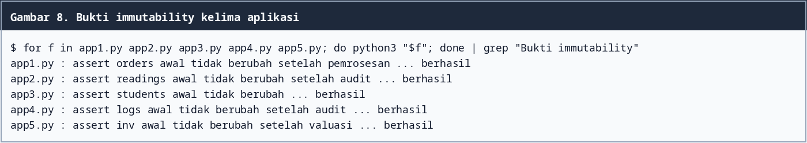

# LAPORAN

Disusun oleh :

Shofa Khafidin (202410370110276)

Istigfaro Choirul Rijal (202410370110249)

Dafa Setya Oriendra (202410370110253)

FAKULTAS TEKNIK

PRODI INFORMATIKA

UNIVERSITAS MUHAMMADIYAH MALANG

TAHUN 2026/2027

---

# Laporan Tugas Pemrograman Fungsional

**Satu Library, Lima Aplikasi: Penerapan Pemrograman Fungsional pada `fplib.py`, `app1.py`–`app5.py` dengan Python**

## 1. Rancangan Sistem

### 1.1 Arsitektur

Sistem terdiri dari tiga lapisan.

1. **Library:** `fplib.py`, kumpulan fungsi umum yang tidak mengetahui aturan bisnis aplikasi mana pun. Library menyediakan dekorator, rekursi murni, immutability berbasis `deepcopy()`, lazy stream, currying, first-class function, dan declarative pipeline.
2. **Aplikasi:** `app1.py` sampai `app5.py`, masing-masing berisi dataset, konstanta, dan aturan studi kasusnya sendiri. Aplikasi memanggil fungsi library; aplikasi tidak menulis ulang fungsi-fungsi tersebut.
3. **Antarmuka:** blok `if __name__ == "__main__":` pada tiap aplikasi, tempat satu-satunya `print()` dan assertion ditaruh.

Lapisan library bersifat generik: ia menerima data, fungsi, atau aturan sebagai argumen, lalu mengembalikan nilai baru. Lapisan aplikasi menentukan *aturan apa* yang dikirimkan ke library. Pemisahan ini membuat perubahan aturan bisnis tidak perlu mengubah `fplib.py`, sebaliknya perbaikan pada library langsung dirasakan oleh kelima aplikasi. Seluruh I/O diisolasi dari fungsi komputasi agar fungsi tetap deterministik dan mudah diuji.

### 1.2 Struktur Berkas

```text
tugas2-fungsional/
├── fplib.py            # core library: dekorator, rekursi, immutability, lazy, curry, pipeline
├── app1.py             # E-Commerce Dynamic Pricing & Order Pipeline
├── app2.py             # IoT Telemetry & Sensor Anomaly Stream Analyzer
├── app3.py             # Academic Gradebook & Scholarship Eligibility Evaluator
├── app4.py             # Server Log Audit & Security Incident Filter
├── app5.py             # Nested Inventory & Warehouse Valuation Engine
├── LAPORAN.md          # sumber laporan ini
├── LAPORAN.docx        # laporan final bergaya M4
├── README.md           # dokumentasi arsitektur dan pemetaan Modul 1–4
├── bukti/              # 8 gambar bukti kode dan keluaran terminal
└── writing-block.md    # spesifikasi tugas
```

Folder `tugas2-fungsional` adalah root repository pribadi `ShofaKhafiiy/tugas2-fungsional` pada branch `main`. Dokumen ini juga disimpan sebagai `LAPORAN.md` dan `LAPORAN.docx` di dalam folder tersebut. File pendukung lain di direktori induk adalah modul PDF dan contoh laporan; semuanya tidak diimpor oleh kode.

### 1.3 Fungsi Library

Berikut ringkasan fungsi dan entitas utama di `fplib.py`.

| No | Fungsi | Peran | Contoh |
|---|---|---|---|
| 1 | `measure_time` | Mengukur durasi eksekusi dan mengembalikan `(hasil, durasi_ms)` | `@measure_time` pada `build_order_report()` |
| 2 | `enforce_immutability` | Menyalin `*args` dan `**kwargs` dengan `deepcopy()` sebelum dipanggil | Dekorator pada `run_pipeline()` |
| 3 | `validate_non_empty` | Menolak argumen pertama yang kosong | `@validate_non_empty` pada `build_scholarship_report()` |
| 4 | `recursive_length` | Menghitung panjang sequence tanpa `len()` | Jumlah order, sensor, mahasiswa, dan item |
| 5 | `recursive_sum` | Menjumlah sequence datar tanpa `sum()` | Menjumlah bobot IPK |
| 6 | `recursive_sum_field` | Menjumlah field pada list of dict | Omzet bersih dan total valuasi gudang |
| 7 | `recursive_flatten` | Meratakan nested list berkedalaman bebas | Inventaris kategori → rak → item |
| 8 | `safe_execute` | Menjalankan fungsi dalam `try-except-else` | Sensor korup dan dataset kosong |
| 9 | `immutable_update_record` | Menghasilkan record baru, termasuk nested dict | Masking IP dan klasifikasi sensor |
| 10 | `lazy_filter_stream` | Generator `yield` untuk filter lazy | Stream anomali sensor |
| 11 | `lazy_transform_stream` | Generator `yield` untuk transformasi lazy | Klasifikasi tingkat bahaya |
| 12 | `curry_filter_by` | Membangun predikat dictionary secara curried | `paid`, `gte`, `eq`, `lt`, `contains` |
| 13 | `curry_transform_field` | Membangun mapper field turunan | `harga_diskon`, `ppn`, `total_bersih` |
| 14 | `curry_rate_adjuster` | `base * (1 + rate/100)` | Diskon −10 dan PPN +11 |
| 15 | `COMPARATORS`, `add_values` | Lambda first-class untuk perbandingan dan reduksi | `eq`, `gte`, `contains`, `acc + val` |
| 16 | `run_pipeline`, `make_*_step` | Mengomposisi `filter()`, `map()`, `reduce()` | Pipeline di app1, app3, app4, app5 |

Contoh implementasi yang menunjukkan gaya tanpa perulangan dan tanpa mutasi:

```python
def recursive_sum_field(records, field_name):
    try:
        head = records[0]
    except IndexError:
        return 0
    else:
        return head[field_name] + recursive_sum_field(records[1:], field_name)
```

Fungsi di atas memakai dekomposisi head-and-tail dan `try-except-else`. Tidak ada `for`, `while`, `len()`, atau `sum()`. Setiap `def` di `fplib.py` juga memiliki docstring dengan bagian `desc:`, `pre-cond:`, dan `post-cond:`.


### 1.4 Matriks Pemakaian Fungsi oleh Aplikasi

Tanda ✓ berarti fungsi atau entitas tersebut dipakai oleh aplikasi.

| Fungsi | app1 | app2 | app3 | app4 | app5 | Jumlah |
|---|---|---|---|---|---|---|
| `measure_time` | ✓ |  |  |  |  | 1 |
| `enforce_immutability` | ✓ |  | ✓ | ✓ | ✓ | 4 |
| `validate_non_empty` |  |  | ✓ |  |  | 1 |
| `recursive_length` | ✓ | ✓ | ✓ |  | ✓ | 4 |
| `recursive_sum` |  |  | ✓ |  |  | 1 |
| `recursive_sum_field` | ✓ |  | ✓ |  | ✓ | 3 |
| `recursive_flatten` |  |  |  |  | ✓ | 1 |
| `safe_execute` |  | ✓ | ✓ |  |  | 2 |
| `immutable_update_record` |  | ✓ | ✓ | ✓ | ✓ | 4 |
| `lazy stream` |  | ✓ |  |  |  | 1 |
| `curry_filter_by` | ✓ | ✓ | ✓ | ✓ | ✓ | 5 |
| `curry_transform_field` | ✓ |  |  |  |  | 1 |
| `curry_rate_adjuster` | ✓ |  |  |  |  | 1 |
| `COMPARATORS`, `add_values` | ✓ | ✓ | ✓ | ✓ | ✓ | 5 |
| `run_pipeline`, adapter | ✓ |  | ✓ | ✓ | ✓ | 4 |

Sebaran pemakaian tidak seragam oleh desain. Fungsi generik seperti `curry_filter_by`, `COMPARATORS`, `add_values`, dan `enforce_immutability` dipakai banyak aplikasi, sedangkan fungsi yang sangat spesifik seperti `measure_time` hanya dipakai `app1.py`. Hal yang terpenting adalah tidak ada aplikasi yang berdiri tanpa pemanggilan library: kelima aplikasi memakai sedikitnya satu entitas `fplib.py`.

### 1.5 Alur Data

Kelima aplikasi tidak saling mengirim state; masing-masing adalah studi kasus mandiri. Alur umum tiap aplikasi adalah:

1. Dataset konstanta dibaca sebagai input.
2. Fungsi filter, map, dan reduce dari `fplib.py` dipanggil.
3. Hasil berupa objek baru; dataset asli tidak disentuh.
4. `format_report()` mengubah hasil menjadi string.
5. `print()` dan `assert` dijalankan hanya di blok `__main__`.

Alur khusus tiap aplikasi: `app1` menyaring paid → subtotal → diskon → PPN → omzet; `app2` menyaring stream sensor → klasifikasi → empat anomali pertama; `app3` menghitung IPK → filter kandidat → rata-rata; `app4` memisahkan error dan endpoint sensitif → insiden → masking → latensi; `app5` meratakan rak → valuasi → stok menipis → rekomendasi restock. Pola ini menunjukkan bahwa satu library yang sama dapat dipakai untuk domain berbeda hanya dengan mengganti aturan berupa fungsi.

## 2. Implementasi

### 2.1 Data Awal (Konstanta di Tiap Aplikasi)

Seluruh data awal ditulis sebagai konstanta immutable di dalam aplikasi.

- `app1.py`: `ORDERS`, 10 pesanan elektronik dengan `items` bersarang. Contoh `ORD-1001` status `paid`, subtotal 1.250.000, tiga item; `ORD-1007` status `pending` sehingga tidak lolos filter awal.
- `app2.py`: `SENSOR_READINGS`, 13 pembacaan suhu/LDR/getaran. Contoh `R01` suhu 38,7; `R03` getaran 46,2; `R06` cahaya 950,0. Tiga pembacaan korup sengaja dibuat: `None`, field `nilai` hilang, dan nilai berupa string.
- `app3.py`: `STUDENTS`, 10 mahasiswa dengan `nilai` bersarang, STATUS `aktif`/`tidak aktif`, dan `WEIGHTS = (lambda n: n["tugas"], lambda n: n["uts"], lambda n: n["uas"])` dengan bobot 0,30/0,30/0,40. IPK minimum beasiswa 3,50.
- `app4.py`: `HTTP_LOGS`, 12 log HTTP dengan `headers` bersarang dan `SENSITIVE_PATHS = ("/admin", "/internal", "/config")`. Contoh insiden terjadi pada `L03`, `L05`, `L06`, dan `L11`.
- `app5.py`: `INVENTORY`, 13 item dalam tiga kategori (Electronics, Furniture, Stationery) dan lima rak bersarang. Contoh `E-01` stok 3 harga 1.250.000; `S-02` stok 2 harga 18.000.

Data bersarang dipilih supaya pembuktian `deepcopy()` dan immutability benar-benar teruji, bukan hanya pada dictionary datar. `immutable_update_record()` dipakai untuk mengubah field pada level atas maupun level dalam tanpa menyentuh objek asli.

### 2.2 Aplikasi 1: E-Commerce Dynamic Pricing (`app1.py`)

Mengelola pesanan paid yang memenuhi subtotal minimum 700.000.

- `is_paid` dibuat dengan `curry_filter_by("status")(COMPARATORS["eq"])("paid")`.
- `eligible_filter` memakai `COMPARATORS["gte"]` terhadap `min_subtotal` 700.000.
- `apply_member_discount`, `add_ppn`, dan `add_net_total` memakai `curry_transform_field()`.
- Diskon 10% memakai `curry_rate_adjuster(-10)`; PPN 11% memakai `curry_rate_adjuster(11)`.
- `build_order_report()` dibungkus `@measure_time` dan merangkai enam langkah pipeline: filter paid, filter subtotal, diskon, PPN, total bersih, lalu ringkasan.
- Omzet dihitung dengan `recursive_sum_field()`, jumlah transaksi dengan `recursive_length()`.
- Dari 10 order, 7 berstatus paid dan 6 lolos subtotal. Omzet bersih akhir 12.787.200,00.

### 2.3 Aplikasi 2: IoT Telemetry (`app2.py`)

Menganalisis aliran pembacaan sensor tanpa langsung menghabiskan seluruh data.

- `THRESHOLDS` memuat batas suhu 37,5, getaran 800, dan cahaya 0,6.
- `is_above_threshold()` membandingkan nilai dengan ambang batas memakai `curry_filter_by()` dan `COMPARATORS["gt"]`.
- `safe_execute()` membungkus perbandingan untuk menangani `None`, field hilang, dan string; tiga data korup dikembalikan sebagai fallback, bukan menyebabkan galat.
- `lazy_filter_stream()` dan `lazy_transform_stream()` memproses sensor satu per satu; klasifikasi memakai faktor pengali 1,1 untuk menandai anomali kritis.
- `itertools.islice()` mengambil empat anomali pertama tanpa menghabiskan stream.
- Generator expression `(row["nilai"] for row in first_anomalies)` mengekstrak nilai numerik 38,7; 46,2; 950,0; 0,82.

### 2.4 Aplikasi 3: Academic Gradebook (`app3.py`)

Mengevaluasi IPK dan kelayakan beasiswa.

- `calculate_ipk()` menjumlahkan hasil tiga lambda `WEIGHTS` memakai `recursive_sum()`.
- `enrich_with_ipk()` menambahkan field `ipk` dengan `immutable_update_record()`.
- `has_min_ipk` memakai `COMPARATORS["gte"]` dengan batas 3,50; `is_active` memakai `COMPARATORS["eq"]` dengan nilai `aktif`.
- `build_scholarship_report()` dibungkus `@validate_non_empty` dan memakai pipeline berfilter, urut, dan format.
- Dataset kosong diuji melalui `safe_execute()` sehingga menghasilkan `ok=False` beserta pesan galat, bukan exception.
- Tiga kandidat lolos dengan NIM 202410370110276, 202410370110253, dan 202410370110301; rata-rata IPK 3,66.

### 2.5 Aplikasi 4: Server Log Audit (`app4.py`)

Mengaudit log HTTP dan insiden keamanan.

- `is_error` memakai `status >= 400`; enam log termasuk kategori error.
- `COMPARATORS["contains"]` dipakai untuk `/admin`, `/internal`, dan `/config`; lima endpoint sensitif ditemukan.
- `and_predicates()` dan `or_predicates()` menyusun predikat curried; kombinasi keduanya menghasilkan empat insiden.
- `mask_ip_address()` mengganti dua oktet terakhir dengan `xxx` secara immutable, misalnya `192.168.45.12` menjadi `192.168.xxx.xxx`.
- `make_reduce_step(add_values, 0)` menghitung total latensi insiden di dalam `run_pipeline()`.
- Total latensi empat insiden 1.720 ms.

### 2.6 Aplikasi 5: Nested Inventory (`app5.py`)

Mengelola inventaris gudang bertingkat.

- `flatten_inventory()` membangun nested list kategori → rak → item lalu memakai `recursive_flatten()`.
- `enrich_valuation()` menambahkan `valuasi = stok * harga_satuan` dengan `immutable_update_record()`.
- `is_low_stock` memakai `curry_filter_by("stok")(COMPARATORS["lt"])(5)`; empat item perlu restock.
- `add_restock_recommendation()` menambahkan jumlah unit hingga target 10, misalnya `E-01` dari stok 3 menjadi 7 unit tambahan.
- `recursive_sum_field()` menghitung total valuasi seluruh aset sebesar 142.048.000.

### 2.7 Isolasi I/O dan Pembuktian Immutability

Seluruh `print()` berada di bawah blok `__main__` pada kelima aplikasi. Fungsi `format_report()` hanya mengembalikan string; fungsi komputasi tidak mencetak apa pun. Pola ini memungkinkan setiap fungsi dipanggil dari pengujian tanpa efek samping ke layar.

Setiap aplikasi membuat salinan cadangan dengan `deepcopy()`, lalu menutup proses dengan assertion seperti `assert ORDERS == orders_backup`. Assertion tersebut membuktikan bahwa pipeline tidak mengubah dataset asli, termasuk dictionary bersarang di dalamnya.

## 3. Pengujian dan Hasil

### 3.1 Pengujian Library dan Aplikasi

Ringkasan berikut mengikuti format tabel cakupan uji pada laporan M4. Yang dihitung adalah jumlah skenario assertion internal yang dijalankan, bukan berkas `pytest` terpisah.

| Fungsi / Entitas | Jumlah skenario | Contoh yang diuji |
|---|---|---|
| `measure_time` | 1 | Durasi eksekusi `build_order_report()` dalam milidetik |
| `enforce_immutability` | 2 | `run_pipeline()` dengan argumen nested; deep copy `*args`/`**kwargs` |
| `validate_non_empty` | 2 | Dataset kosong ditolak; dataset berisi diterima |
| `recursive_length` | 2 | Sequence kosong; 10 order pada `app1.py` |
| `recursive_sum` | 2 | Sequence kosong; tiga bobot IPK pada `app3.py` |
| `recursive_sum_field` | 2 | Omzet `app1.py`; valuasi `app5.py` |
| `recursive_flatten` | 2 | Nested tiga level pada inventaris; nested kosong |
| `safe_execute` | 3 | Fungsi sukses; fallback saat exception; data sensor korup |
| `immutable_update_record` | 2 | Update field datar; update field nested |
| `lazy stream` | 2 | Filter object menghasilkan nilai; transformasi menghasilkan label |
| `curry`, `COMPARATORS`, `add_values`, pipeline | 7 | `eq/gte/lt/contains`; diskon/PPN; reduksi; pipeline enam langkah |

Perintah pengecekan utama: `python3 -m py_compile fplib.py app1.py app2.py app3.py app4.py app5.py`, diikuti kelima aplikasi. Seluruh assertion berhasil dan tidak ada runtime exception. Pemeriksaan AST memastikan semua `def` memiliki docstring `desc/pre-cond/post-cond` dan rekursi tidak memakai `for`, `while`, `len()`, atau `sum()`.

Catatan: proyek ini belum memiliki berkas `test_fplib.py` terpisah. Pengujian dilakukan lewat assertion internal di tiap aplikasi dan pemeriksaan AST seperti pada tabel di atas.


### 3.2 Hasil Skenario

Berikut keluaran nyata dari kelima aplikasi. Karena kelima studi kasus mandiri, penyajiannya dibagi menjadi lima langkah, mirip dengan penyajian skenario gabungan pada laporan M4.

**Langkah 1: E-Commerce Dynamic Pricing.** Dari 10 pesanan, filter status menyisakan 7 paid. Filter subtotal minimum 700.000 menyisakan 6 transaksi. Diskon member 10% dan PPN 11% diterapkan berurutan, lalu omzet bersih dihitung. Hasil akhir 12.787.200,00 dalam 0,31 ms (durasi dapat berbeda setiap eksekusi).


**Langkah 2: IoT Telemetry.** Stream 13 pembacaan diproses lazy. Tiga data korup ditangani `safe_execute()`, empat anomali pertama berhasil diambil, dan nilai numeriknya diekstrak. Tidak ada pembacaan yang diubah.


**Langkah 3: Academic Gradebook.** Sepuluh mahasiswa diberi field IPK baru. Filter IPK minimal 3,50 dan status aktif menghasilkan tiga kandidat dengan rata-rata IPK 3,66. Uji dataset kosong menghasilkan pesan galat yang diharapkan.


**Langkah 4: Server Log Audit.** Enam log error dan lima endpoint sensitif ditemukan. Kombinasi keduanya menghasilkan empat insiden pada `L03`, `L05`, `L06`, dan `L11`. IP pada insiden dimasking, total latensi 1.720 ms.


**Langkah 5: Nested Inventory.** Nested inventory diratakan menjadi 13 item. Empat item dengan stok di bawah 5 mendapat rekomendasi restock ke target 10. Total valuasi gudang 142.048.000.


Berikut ringkasan angka yang diambil dari keluaran terminal tersebut.

| Aplikasi | Metrik | Nilai |
|---|---|---|
| `app1.py` | Jumlah seluruh pesanan | 10 |
| `app1.py` | Jumlah pesanan paid | 7 |
| `app1.py` | Transaksi lolos subtotal | 6 |
| `app1.py` | Total omzet bersih | 12.787.200,00 |
| `app2.py` | Jumlah pembacaan mentah | 13 |
| `app2.py` | Anomali pertama | R01, R03, R04, R06 |
| `app2.py` | Nilai numerik terekstrak | 38,7; 46,2; 950,0; 0,82 |
| `app2.py` | Data korup tertangani | 3 |

| Aplikasi | Metrik | Nilai |
|---|---|---|
| `app3.py` | Kandidat beasiswa | 3 |
| `app3.py` | NIM kandidat | 202410370110276, 202410370110253, 202410370110301 |
| `app3.py` | Rata-rata IPK | 3,66 |
| `app3.py` | Validasi dataset kosong | `ok=False`, pesan error muncul |
| `app4.py` | Log error | 6 |
| `app4.py` | Endpoint sensitif | 5 |
| `app4.py` | Insiden error dan sensitif | L03, L05, L06, L11 |
| `app4.py` | Total latensi insiden | 1.720 ms |

| Aplikasi | Metrik | Nilai |
|---|---|---|
| `app5.py` | Item setelah flatten | 13 |
| `app5.py` | Item perlu restock | 4 |
| `app5.py` | SKU restock | E-01, E-04, F-02, S-02 |
| `app5.py` | Total valuasi aset | 142.048.000 |
| `app1.py` | Bukti immutability | `assert ORDERS == orders_backup`, lulus |
| `app2.py` | Bukti immutability | `assert SENSOR_READINGS == readings_backup`, lulus |
| `app3.py` | Bukti immutability | `assert STUDENTS == students_backup`, lulus |
| `app4.py` | Bukti immutability | `assert HTTP_LOGS == logs_backup`, lulus |
| `app5.py` | Bukti immutability | `assert INVENTORY == inventory_backup`, lulus |

Durasi eksekusi `app1.py` bersifat dinamis karena diukur dengan `perf_counter()`, sehingga angka milidetik dapat berbeda setiap eksekusi. Kelima assertion immutability selalu lulus karena setiap operasi menghasilkan objek baru.



### 3.3 Pembahasan

**a. Fungsi buatan sendiri yang umum dapat dipakai ulang**

Seluruh fungsi di `fplib.py` didefinisikan dengan `def`, memiliki parameter jelas, dan docstring `desc/pre-cond/post-cond`. Fungsi tersebut tidak mengetahui detail pesanan, sensor, mahasiswa, log, atau gudang, sehingga dapat dipakai ulang oleh aplikasi mana pun. `curry_filter_by()`, misalnya, dipakai untuk status paid di `app1.py`, ambang sensor di `app2.py`, IPK di `app3.py`, endpoint sensitif di `app4.py`, dan stok rendah di `app5.py`. Yang berbeda hanya operator dan nilai yang dikirimkan; isi fungsinya tetap sama. Hal ini sejalan dengan matriks pemakaian pada subbab 1.4.

**b. Fungsi murni memudahkan pengujian**

Karena fungsi komputasi tidak melakukan I/O dan tidak mengubah input, pengujian cukup membandingkan nilai keluaran dengan nilai yang diharapkan. Tidak perlu menyiapkan kondisi global atau membersihkan state setelah pengujian. Assertion immutability di akhir tiap aplikasi membuktikan bahwa data awal tetap sama setelah pipeline dijalankan, termasuk dictionary bersarang. Perilaku ini juga membuat hasil `recursive_sum_field()` pada omzet dan valuasi dapat diverifikasi ulang kapan saja.

**c. Parameter bawaan dan variadik membuat fungsi fleksibel**

`safe_execute(func, *args, fallback=None, **kwargs)` menerima jumlah argumen apa pun dan menyediakan nilai fallback bila fungsi gagal. `run_pipeline(dataset, *steps)` menerima jumlah langkah pipeline yang berbeda-beda: enam langkah di `app1.py`, empat di `app3.py`, dan tiga di `app4.py`. Closure pada fungsi curry menyimpan konfigurasi antar tahap pemanggilan, sehingga `gte(700000)` dapat dipakai ulang tanpa menulis fungsi baru. Fleksibilitas ini mengurangi duplikasi kode secara nyata.

**d. Fungsi sebagai argumen dan komposisi dengan pipeline**

`COMPARATORS`, `add_values`, predikat, dan transformer semuanya dikirim sebagai argumen. `run_pipeline()` mengomposisikannya dari kiri ke kanan sehingga alur data dapat dibaca như urutan langkah. Pada `app1.py`, perubahan diskon cukup mengganti `curry_rate_adjuster(-10)` menjadi nilai lain; pipeline sisanya tidak perlu diubah. Pada `app4.py`, reduksi latensi cukup memakai `make_reduce_step(add_values, 0)`. Perubahan aturan menjadi lokal dan mudah ditelusuri.

**e. Fungsi pembantu tetap berada di aplikasi**

Fungsi yang hanya dibutuhkan satu studi kasus, seperti `is_above_threshold()` di `app2.py`, `mask_ip_address()` di `app4.py`, dan `enrich_valuation()` di `app5.py`, sengaja tidak dimasukkan ke `fplib.py`. Fungsi tersebut memang bergantung pada bentuk data domain tertentu. Library tetap berisi fungsi umum, sementara aturan bisnis tetap dekat dengan datanya. Pemisahan ini mencegah `fplib.py` membengkak menjadi "tempat sampah" fungsi aplikasi.

## 4. Penutup

### 4.1 Kesimpulan

Berdasarkan perancangan, implementasi, dan pengujian yang telah dilakukan, library `fplib.py` berhasil menyediakan fondasi fungsional untuk kelima aplikasi. Rekursi, immutability, lazy evaluation, currying, first-class function, dan dekorator tidak hanya didefinisikan, tetapi benar-benar dipakai dalam studi kasus. Sebaran pemakaian menunjukkan fungsi generik dipakai lintas aplikasi, sementara fungsi khusus tetap berada di aplikasi yang membutuhkannya.

Penerapan fungsi murni dan data yang tidak diubah membuat kode lebih mudah diuji. Hal ini dibuktikan dengan keberhasilan seluruh assertion immutability dan tidak adanya mutasi pada dataset asli. Kelima aplikasi berjalan tanpa runtime exception dan menghasilkan output terminal yang informatif. Dengan demikian, tujuan proyek untuk membangun satu library fungsional yang dapat dipakai oleh lima aplikasi dapat dinyatakan tercapai.

### 4.2 Saran

Pengembangan berikutnya dapat menambahkan berkas `test_fplib.py` dengan kerangka pengujian standar agar setiap fungsi library memiliki uji unit terpisah. Selain itu, rangkaian perintah menjalankan kelima aplikasi dapat digabungkan ke satu skrip verifikasi agar pemeriksaan akhir lebih cepat. Jika diperlukan, bukti terminal pada Lampiran atau folder `bukti/` dapat diperbarui otomatis setiap kali aplikasi dijalankan.

---

## Lampiran A. Cara Menjalankan

```bash
git clone -b main https://github.com/ShofaKhafiiy/tugas2-fungsional.git
cd tugas2-fungsional
python3 -m py_compile fplib.py app1.py app2.py app3.py app4.py app5.py
python3 app1.py
python3 app2.py
python3 app3.py
python3 app4.py
python3 app5.py
```

Semua perintah dijalankan dari root repository `tugas2-fungsional`. Jika repository sudah di-clone, cukup jalankan `git pull origin main` lalu masuk ke folder tersebut. Tidak perlu memasang pustaka eksternal karena seluruh kode hanya memakai Python Standard Library.

## Lampiran B. Repository

Kode dikelola dengan Git di repository tugas2-fungsional (branch main) dan dikerjakan bersama oleh anggota kelompok lewat commit dan push/pull. ShofaKhafiiy/tugas2-fungsional: Tugas Pemrograman Fungsional Modul 1–4

URL repository: https://github.com/ShofaKhafiiy/tugas2-fungsional

Berkas utama berada langsung di root repository: `fplib.py`, `app1.py`, `app2.py`, `app3.py`, `app4.py`, `app5.py`, `README.md`, `LAPORAN.md`, dan `LAPORAN.docx`. Bukti visual berupa delapan gambar tersimpan di folder `bukti/` dan tertanam pula di dalam `LAPORAN.docx`.
